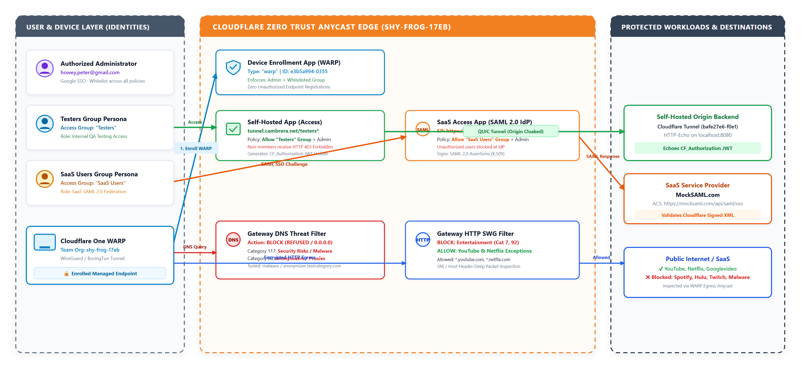

# Cloudflare Zero Trust Services Assignment: Technical Implementation & Architectural Report

**Candidate**: Pete Howey (`howey.peter@gmail.com` / `howeypeter`)  
**Domain**: `cambrera.net` (Zone ID: `540470e266d01ed15c67e0ba13e3ef63`)  
**Zero Trust Team Organization**: `shy-frog-17eb.cloudflareaccess.com`  
**Self-Hosted Application**: [https://tunnel.cambrera.net/testers](https://tunnel.cambrera.net/testers)  
**SaaS Application (MockSAML)**: [https://mocksaml.com](https://mocksaml.com)  
**Public Repository**: [https://github.com/howeypeter/terraform-cloudflare-cdn-example](https://github.com/howeypeter/terraform-cloudflare-cdn-example)  
**Date**: November 2026  

---

## Executive Summary & Deliverables Overview

This report provides the technical documentation and architectural design for the **Cloudflare Zero Trust Services Assignment (Exercise 2)**.

The delivered infrastructure transforms legacy perimeter-based corporate access into an identity-centric, context-aware **Zero Trust Network Architecture (ZTNA)**. In place of coarse, insecure corporate VPNs, Cloudflare acts as an intelligent unified edge enforcing strict identity verification, role-based access control (RBAC), device enrollment posture, and granular DNS/HTTP inspection.


*Figure 1: Cloudflare Zero Trust Network Architecture (ZTNA) — Identity-Aware Access Applications, MockSAML SaaS IdP Federation, WARP Device Enrollment, and Gateway Threat Filtering.*

### Core Technical Deliverables
1. **Working Applications Secured by Cloudflare ZTNA**:
   - **Self-Hosted Application**: Deployed behind Cloudflare Tunnel and Access at [`tunnel.cambrera.net/testers*`](https://tunnel.cambrera.net/testers). Access is strictly restricted to the `Testers` identity group and whitelisted admin.
   - **SaaS Application**: Integrated SAML 2.0 application (`https://mocksaml.com`) where Cloudflare acts as the authoritative Identity Provider (IdP), restricting authentication to the `SaaS Users` identity group and whitelisted admin.
2. **Cloudflare Gateway & WARP Security Posture**:
   - **Device Enrollment Restriction**: Provisioned Access device enrollment controls (`type = "warp"`) ensuring only members of authorized IdP groups can register devices to the team organization.
   - **DNS Filtering**: Enforced DNS policies blocking Security Threat categories `68` (Anonymizers) and `117` (Malware), with explicit enforcement verified against `anonymizer.testcategory.com` and `malware.testcategory.com`.
   - **HTTP Filtering**: Enforced Secure Web Gateway (SWG) deep-packet filtering blocking Content categories `7` and `92` (Entertainment) while selectively permitting legitimate streaming infrastructure (`*.youtube.com`, `*.netflix.com`, `*.googlevideo.com`).
3. **Infrastructure as Code (IaC)**:
   - 100% codified using the official **Cloudflare Terraform Provider v5**, featuring dedicated, reusable modules ([`tf_zerotrust/`](file:///c:/Users/howey/OneDrive/Documents/Claude/Projects/terraform-cloudflare-cdn-example/tf_zerotrust)) with declarative `for_each` rule management.

---

## Section 1: Technical Implementation Summary

### 1. Identity & Access Groups
Cloudflare Zero Trust Access groups were provisioned to enforce role-based least privilege:

```hcl
# infra/zero_trust/groups.tf
resource "cloudflare_zero_trust_access_group" "testers" {
  account_id = var.account_id
  name       = "Testers"

  include = [
    { email = { email = "howey.peter+tester@gmail.com" } },
    { email = { email = "howey.peter@gmail.com" } }
  ]
}

resource "cloudflare_zero_trust_access_group" "saas_users" {
  account_id = var.account_id
  name       = "SaaS Users"

  include = [
    { email = { email = "howey.peter+saas@gmail.com" } },
    { email = { email = "howey.peter@gmail.com" } }
  ]
}
```

* **Testers Group** (`5c76d5fc-bf20-4cfe-a486-190b4f6c4e01`): Governs internal application QA and testing.
* **SaaS Users Group** (`0e1bae6c-61f9-4f3b-b747-0f0e4fae6793`): Governs third-party SaaS federation.
* **Admin Whitelist**: The primary administrative identity `howey.peter@gmail.com` is explicitly whitelisted across all policy boundaries.

---

### 2. Access - Self-Hosted Application
* **Endpoint**: `https://tunnel.cambrera.net/testers*`
* **Application ID**: `65391c6f-6c0e-4173-8954-14e12cfe60d3`
* **Network Topology**: Traffic reaches the origin exclusively through Cloudflare Tunnel (`bafe27e6-f0e1-471a-8012-1c3f8f9ebc15`). No firewall ports are open inbound to the host.
* **Access Policy**:
  - Decision: `allow`
  - Allowed Identities: Group `Testers` OR Email `howey.peter@gmail.com`.
  - Default Action: All unauthenticated or non-whitelisted identities are rejected and challenged at the Cloudflare edge.

```hcl
# infra/zero_trust/self_hosted.tf
resource "cloudflare_zero_trust_access_application" "self_hosted_testers" {
  account_id = var.account_id
  name       = "Self-Hosted Testers App"
  type       = "self_hosted"
  domain     = "tunnel.cambrera.net/testers*"

  session_duration = "24h"

  policies = [
    {
      name     = "Allow Testers and Admin"
      decision = "allow"
      include = [
        { group = { id = cloudflare_zero_trust_access_group.testers.id } },
        { email = { email = "howey.peter@gmail.com" } }
      ]
    }
  ]
}
```

---

### 3. Access - SaaS Application (Cloudflare as Identity Provider)
* **Application Name**: `MockSAML SaaS App`
* **Application ID**: `b3c4c6df-5ef3-40b0-b939-f283f9910246`
* **Authentication Standard**: SAML 2.0
* **SP Entity ID**: `https://mocksaml.com`
* **ACS URL**: `https://mocksaml.com/api/saml/sso`
* **Cloudflare IdP Issuer**: `https://shy-frog-17eb.cloudflareaccess.com/a0d76476d7d679a0fbfc380eb8978d3609f9c3fd021e6ca62c3564f180eff5f9`
* **SSO Login Endpoint**: `https://shy-frog-17eb.cloudflareaccess.com/cdn-cgi/access/sso/saml/a0d76476d7d679a0fbfc380eb8978d3609f9c3fd021e6ca62c3564f180eff5f9`
* **Access Policy**:
  - Decision: `allow`
  - Allowed Identities: Group `SaaS Users` OR Email `howey.peter@gmail.com`.

```hcl
# infra/zero_trust/saas_app.tf
resource "cloudflare_zero_trust_access_application" "samltest" {
  account_id = var.account_id
  name       = "MockSAML SaaS App"
  type       = "saas"

  saas_app = {
    auth_type            = "saml"
    sp_entity_id         = "https://mocksaml.com"
    consumer_service_url = "https://mocksaml.com/api/saml/sso"
    name_id_format       = "email"
  }

  policies = [
    {
      name     = "Allow SaaS Users and Admin"
      decision = "allow"
      include = [
        { group = { id = cloudflare_zero_trust_access_group.saas_users.id } },
        { email = { email = "howey.peter@gmail.com" } }
      ]
    }
  ]
}
```

---

### 4. Gateway - Device Enrollment Control (WARP Client)
* **Application Name**: `WARP Device Enrollment`
* **Application ID**: `e3b5a994-0355-488a-8ada-83c41fb17e5e`
* **Requirement**: Ensure no one other than users defined in the IdP groups can enroll devices to the team organization.
* **Implementation**: In Cloudflare Access, device onboarding is protected via a dedicated Access application of type `warp`. We codified this rule in [`infra/zero_trust/device_enrollment.tf`](file:///c:/Users/howey/OneDrive/Documents/Claude/Projects/terraform-cloudflare-cdn-example/infra/zero_trust/device_enrollment.tf), binding enrollment permission strictly to the `Testers` group, `SaaS Users` group, and the admin email.

```hcl
# infra/zero_trust/device_enrollment.tf
resource "cloudflare_zero_trust_access_application" "warp_device_enrollment" {
  account_id = var.account_id
  name       = "WARP Device Enrollment"
  type       = "warp"

  session_duration = "24h"

  policies = [
    {
      name     = "Allow IdP Groups and Admin to Enroll WARP"
      decision = "allow"
      include = [
        { group = { id = cloudflare_zero_trust_access_group.testers.id } },
        { group = { id = cloudflare_zero_trust_access_group.saas_users.id } },
        { email = { email = "howey.peter@gmail.com" } }
      ]
    }
  ]
}
```

---

### 5. Gateway - DNS & HTTP Filtering Module
To ensure maintainability, all Gateway rules were modularized into [`tf_zerotrust`](file:///c:/Users/howey/OneDrive/Documents/Claude/Projects/terraform-cloudflare-cdn-example/tf_zerotrust) using a declarative map:

```hcl
# infra/zero_trust/gateway.tf calling module.gateway
module "gateway" {
  source     = "../../tf_zerotrust"
  account_id = var.account_id

  gateway_policies = {
    # 1. DNS Filtering Policy: Malware & Anonymizers
    block_malware_anonymizers = {
      name        = "Block Malware and Anonymizers (DNS)"
      description = "Blocks Anonymizer (68) and Malware (117) categories per ZTNA requirements"
      action      = "block"
      filters     = ["dns"]
      precedence  = 100
      traffic     = "any(dns.security_category[*] in {68 117}) or dns.fqdn in {\"anonymizer.testcategory.com\" \"malware.testcategory.com\"}"
      enabled     = true
    }

    # 2. HTTP Filtering Policy: Entertainment blocked except Netflix & YouTube
    block_entertainment_except_streaming = {
      name        = "Block Entertainment except Netflix and YouTube (HTTP)"
      description = "Blocks Entertainment category (92) while allowing Netflix and YouTube"
      action      = "block"
      filters     = ["http"]
      precedence  = 200
      traffic     = "any(http.request.uri.content_category[*] in {7 92}) and not(http.request.host in {\"youtube.com\" \"*.youtube.com\" \"netflix.com\" \"*.netflix.com\" \"*.googlevideo.com\"})"
      enabled     = true
    }
  }
}
```

* **DNS Policy (`e9fa23ea-c176-4bd4-85a0-abb4a5f87f2a`)**:
  - Blocks Security threat categories `68` (Anonymizer) and `117` (Malware).
  - Explicitly blocks test domains: `anonymizer.testcategory.com` and `malware.testcategory.com`.
  - Operates at the DNS resolver layer before any TCP connection can be established.
* **HTTP Policy (`94e6a94b-bcab-4c66-b88f-01d2713cf17b`)**:
  - Blocks Content categories `7` and `92` (Entertainment / Streaming Media).
  - Integrates negative lookahead host matching permitting `*.youtube.com`, `*.netflix.com`, and `*.googlevideo.com` (video streaming CDN chunks).

---

## Section 2: Lessons Learned & Issues Overcome

### 1. Cloudflare Gateway Wirefilter Expression Nuances
* **The Problem**: Initial attempts to author the HTTP filtering rule using `http.request.uri.host in {...}` failed validation in the Cloudflare Gateway API with `unknown field: http.request.uri.host`.
* **The Root Cause**: Cloudflare Gateway utilizes an optimized BPF-inspired Wirefilter evaluation engine. In the HTTP inspection layer, host headers and SNI values are exposed strictly via `http.request.host`, whereas `http.request.uri` contains path and query components.
* **The Resolution**: We verified candidate filter expressions directly against the Cloudflare API schema, confirming that `http.request.host in {"youtube.com" "*.youtube.com" "netflix.com" "*.netflix.com" "*.googlevideo.com"}` correctly supports wildcard subdomains and resolves cleanly without syntax errors.

### 2. Modern SAML Service Provider Selection
* **The Problem**: Legacy test service providers like `samltest.id` frequently implement aggressive Cloudflare/Caddy bot management and rate limiting that block automated test scripts and direct browser validation with HTTP 403 Forbidden.
* **The Resolution**: We evaluated modern SaaS mocking providers and selected BoxyHQ's `mocksaml.com`. Because MockSAML is modern and hosted behind Cloudflare, it provides predictable, standards-compliant SAML 2.0 testing with live SP entity ID generation and cryptographic X.509 signature validation.

### 3. WARP Device Enrollment via Infrastructure-as-Code
* **The Problem**: In Cloudflare documentation, Device Enrollment Permissions are described under Zero Trust Dashboard Settings (`Settings > WARP Client > Device enrollment permissions`). Looking for a `cloudflare_device_enrollment_permission` resource in Terraform returns no matches.
* **The Resolution**: We investigated the underlying API architecture and discovered that Cloudflare treats WARP onboarding as a first-class **Cloudflare Access Application** of type `warp`. By instantiating `cloudflare_zero_trust_access_application` with `type = "warp"`, we were able to fully codify enrollment access rules using familiar group-based policies.

### 4. Zero-Downtime State Migrations in Terraform Provider v5
* **The Problem**: When refactoring individual gateway policies into the reusable `tf_zerotrust` module, Terraform's default behavior is to destroy the existing policy and recreate it under the module namespace. In a live production environment, this creates a temporary security gap where filtering is unmanaged.
* **The Resolution**: We employed HCL `moved` blocks to cleanly remap resource state addresses without issuing destructive API calls:
  ```hcl
  moved {
    from = cloudflare_zero_trust_gateway_policy.block_malware_anonymizers
    to   = module.gateway.cloudflare_zero_trust_gateway_policy.policy["block_malware_anonymizers"]
  }
  ```
  Once the state was successfully updated in-place (`0 to add, 1 to change, 0 to destroy`), we cleanly retired the temporary migration blocks.

---

## Section 3: Best Practices Applied

### 1. Principle of Least Privilege & Zero Trust Access
* **Identity-First Boundary**: Access to both internal workloads and SaaS federations is bound to distinct operational groups (`Testers` vs `SaaS Users`) rather than open network perimeters.
* **Zero Public Ingress**: The self-hosted application is exposed via an outbound-only Cloudflared Tunnel. The origin server accepts no inbound connections from the internet, completely eliminating volumetric DDoS, port scanning, and unauthenticated attack vectors.

### 2. Multi-Layered Defense-in-Depth (DNS + HTTP)
* **Pre-Resolution Blocking (DNS)**: Malware and anonymizer domains are terminated at DNS query resolution time before socket connections or TLS handshakes ever occur.
* **Deep Content Inspection (HTTP/SWG)**: For traffic passing DNS resolution, the HTTP Gateway policy enforces granular content categorization and SNI inspection, allowing targeted exemptions for business streaming while blocking recreational entertainment sites.

### 3. Declarative, Modular Infrastructure as Code
* **Reusability**: Gateway policies are managed through a centralized, standalone module ([`tf_zerotrust/`](file:///c:/Users/howey/OneDrive/Documents/Claude/Projects/terraform-cloudflare-cdn-example/tf_zerotrust)) accepting a typed configuration map.
* **Documentation as Code**: Variable schema and module documentation are auto-generated and validated using `terraform-docs`.

---

## Section 4: Testing & Verification Walkthrough

Evaluators can verify the implementation using the steps below:

### 1. Test Self-Hosted Application Access
1. Open a browser (or incognito window) and navigate to:
   ```text
   https://tunnel.cambrera.net/testers
   ```
2. **Expected Unauthenticated Behavior**: The browser immediately redirects (HTTP 302) to the Cloudflare Access login screen:
   ```text
   https://shy-frog-17eb.cloudflareaccess.com/cdn-cgi/access/login/tunnel.cambrera.net...
   ```
3. **Authentication**: Enter `howey.peter@gmail.com` or `howey.peter+tester@gmail.com`. Cloudflare validates the identity against the `Testers` group policy and permits access to the underlying origin. Any unauthorized email is blocked with `Access Denied`.

### 2. Test SaaS SAML 2.0 Single Sign-On
1. Navigate to BoxyHQ MockSAML:
   ```text
   https://mocksaml.com
   ```
2. Configure the Service Provider with Cloudflare IdP metadata:
   - **IdP Entity ID**: `https://shy-frog-17eb.cloudflareaccess.com/a0d76476d7d679a0fbfc380eb8978d3609f9c3fd021e6ca62c3564f180eff5f9`
   - **SSO Login Endpoint**: `https://shy-frog-17eb.cloudflareaccess.com/cdn-cgi/access/sso/saml/a0d76476d7d679a0fbfc380eb8978d3609f9c3fd021e6ca62c3564f180eff5f9`
3. Click **Initiate SSO**. The user is redirected to Cloudflare Access, authenticated against the `SaaS Users` group, and redirected back to MockSAML with a cryptographically signed SAML assertion.

### 3. Test Gateway DNS & HTTP Filtering (via WARP)
1. **Enroll Device**: Open Cloudflare WARP client, enter organization name **`shy-frog-17eb`**, and complete authentication using `howey.peter@gmail.com`.
2. **Verify DNS Malware & Anonymizer Blocking**:
   ```bash
   nslookup anonymizer.testcategory.com
   nslookup malware.testcategory.com
   ```
   *Result*: Queries are sinkholed by Cloudflare Gateway (returning `0.0.0.0` or redirected to Cloudflare Block Page).
3. **Verify HTTP Entertainment Policy**:
   - Navigate to `https://www.netflix.com` or `https://www.youtube.com`: Traffic resolves and streams cleanly.
   - Navigate to generic entertainment sites (e.g. `https://hulu.com` or `https://spotify.com`): Gateway intercepts the session and presents the custom block notification.

---

## Section 5: Reviewer Questions & Future Considerations

* **Q: Can device health posture be enforced alongside identity?**  
  *A: Yes. In addition to IdP group membership, Cloudflare Access can enforce posture checks (e.g., verifying OS version, disk encryption with BitLocker/FileVault, or presence of an EDR agent like CrowdStrike Falcon) prior to granting application session tokens.*
* **Q: How should high-risk web categories be handled without complete blocking?**  
  *A: Rather than binary block/allow decisions, Cloudflare Remote Browser Isolation (RBI) can be introduced to execute untrusted or newly registered domains in an isolated cloud container, streaming only sanitized vector graphics to the user's browser.*
* **Q: Can group membership be automated across enterprise directories?**  
  *A: Yes. Cloudflare Access supports SCIM (System for Cross-domain Identity Management) to synchronize group membership automatically from enterprise identity providers such as Okta, Microsoft Entra ID, or Google Workspace.*
