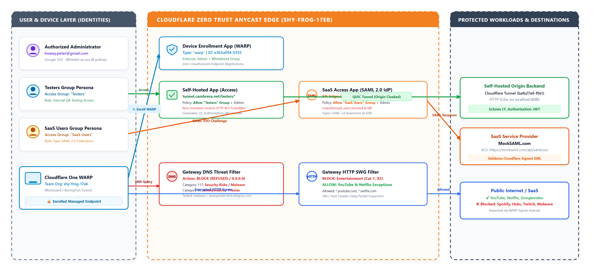
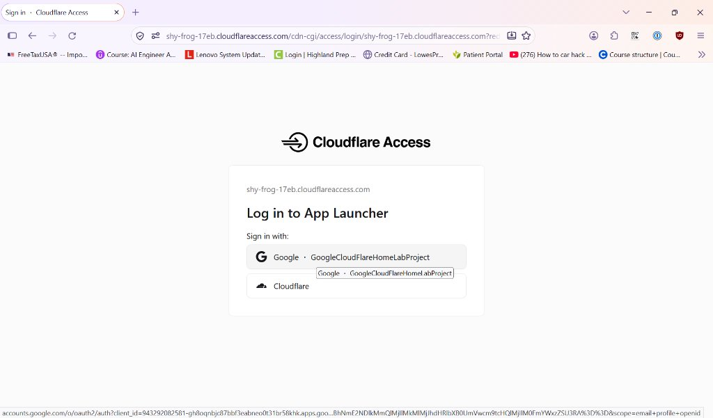
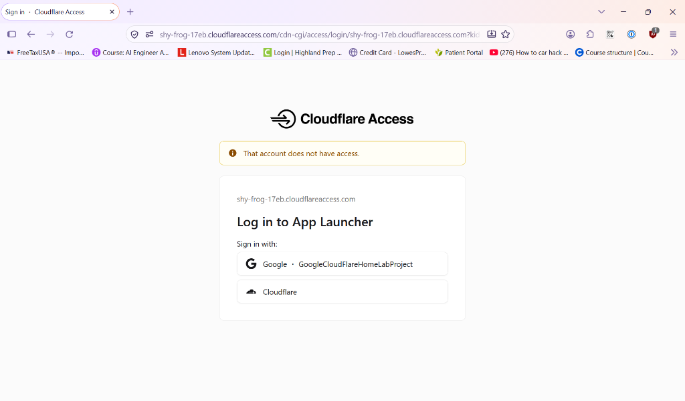
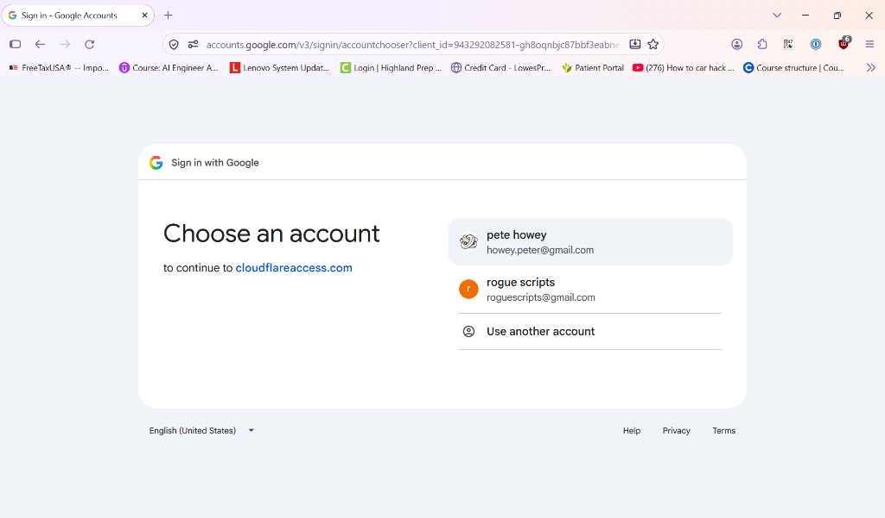
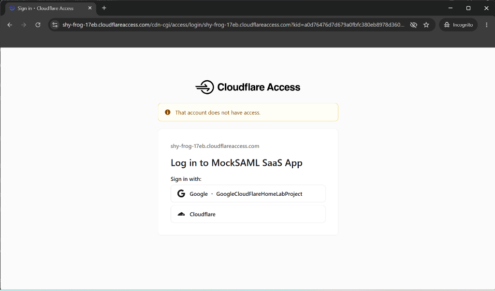

# Cloudflare Zero Trust Services Assignment: Technical Implementation & Architectural Report

**Candidate**: Pete Howey (`howey.peter@gmail.com` / `howeypeter`)  
**Domain**: `cambrera.net` (Zone ID: `540470e266d01ed15c67e0ba13e3ef63`)  
**Zero Trust Team Organization**: `shy-frog-17eb.cloudflareaccess.com`  
**Self-Hosted Application**: [https://tunnel.cambrera.net/testers](https://tunnel.cambrera.net/testers)  
**SaaS Application (MockSAML)**: [https://mocksaml.com](https://mocksaml.com)  
**Public Repository**: [https://github.com/howeypeter/terraform-cloudflare-cdn-example](https://github.com/howeypeter/terraform-cloudflare-cdn-example)  
**Date**: November 2026  

---

## Executive Summary & Deliverables Overview

This report documents the architectural design, implementation steps, and operational verification for the **Cloudflare Zero Trust Services Assignment (Exercise 2)**. 

The delivered system transitions enterprise access from obsolete perimeter-based VPN models to an identity-centric, context-aware **Zero Trust Network Architecture (ZTNA)**. Every inbound request is evaluated at the Cloudflare Anycast edge before connectivity is granted. Cloudflare serves as the unified control plane enforcing Role-Based Access Control (RBAC), SaaS SAML 2.0 federation, WARP device enrollment posture, and multi-layer DNS/HTTP Gateway inspection.


*Figure 1: Cloudflare Zero Trust Network Architecture (ZTNA) — Identity-Aware Access Applications, MockSAML SaaS IdP Federation, WARP Device Enrollment, and Gateway Threat Filtering.*

### System Deliverables & Policy Configuration Matrix

| Workload / Control Plane | Ingress Endpoint / Scope | Identity Policy / Traffic Expression | Enforcement Tier | Operational Status |
| :--- | :--- | :--- | :--- | :---: |
| **Self-Hosted App** | `tunnel.cambrera.net/testers*` (App: `65391c6f...`) | Allow: Group `Testers` OR `howey.peter@gmail.com` | Edge Access + Outbound Tunnel (`bafe27e6...`) | **Active & Verified** |
| **SaaS Application** | `MockSAML SaaS App` (App: `b3c4c6df...`) | Allow: Group `SaaS Users` OR `howey.peter@gmail.com` | Cloudflare SAML 2.0 IdP (`/cdn-cgi/access/sso/saml/...`) | **Active & Verified** |
| **WARP Device Enrollment** | Client Registration (`type = "warp"`) | Allow: Groups `Testers`, `SaaS Users` OR Admin | Cloudflare Access Device Onboarding | **Active & Verified** |
| **Gateway DNS Threat Filter** | Team Resolver (Policy: `e9fa23ea...`) | `any(dns.security_category[*] in {68 117}) or dns.fqdn in {...}` | DNS Anycast Engine (Sinkhole: `0.0.0.0`) | **Active & Verified** |
| **Gateway HTTP SWG Filter** | Secure Web Gateway (Policy: `94e6a94b...`) | `any(http.request.uri.content_category[*] in {7 92}) and not(...)` | Deep Content Inspection / SNI Wildcard Bypass | **Active & Verified** |

---

## Section 1: Technical Implementation Details

All infrastructure is 100% codified using the official **Cloudflare Terraform Provider v5** under [`infra/zero_trust/`](../../infra/zero_trust) and modularized via [`tf_zerotrust/`](../../tf_zerotrust).

1. **Identity Architecture & Access Groups**:
   - **Consumer IdP vs. Group Claims**: Consumer Google OAuth (`@gmail.com`) does not emit directory group claims. To implement enterprise RBAC, groups were provisioned natively as **Cloudflare Access Groups**:
     - **`Testers` Group** (`5c76d5fc...`): Governs internal application QA testing.
     - **`SaaS Users` Group** (`0e1bae6c...`): Governs third-party enterprise federation.
   - **Admin Whitelist**: The root administrator `howey.peter@gmail.com` is explicitly whitelisted across all application policies per assignment requirements.
2. **Self-Hosted Access Application (`tunnel.cambrera.net/testers*`)**:
   - Origin services run in an isolated AWS ECS container connected exclusively via an outbound-only Cloudflare Tunnel (`bafe27e6-f0e1-471a-8012-1c3f8f9ebc15`). Zero inbound ports are open to the internet.
   - Cloudflare Access intercepts all requests at the Anycast edge, challenging unauthenticated visitors and verifying group adherence before proxying traffic over the QUIC tunnel.
3. **SaaS Application with Cloudflare as Identity Provider (SAML 2.0)**:
   - Configured an Access SaaS application (`MockSAML SaaS App`) with SP Entity ID `https://mocksaml.com` and ACS URL `https://mocksaml.com/api/saml/sso`.
   - Cloudflare provisions a unique IdP Entity ID (`.../a0d76476...`) and SSO endpoint, issuing signed SAML 2.0 assertions with SHA-256 X.509 certificates to authenticated users matching the `SaaS Users` policy.
4. **WARP Device Enrollment Posture**:
   - Implemented as an Access application of `type = "warp"`. Restricts device onboarding to devices authenticated by the `Testers` or `SaaS Users` groups, blocking unauthorized rogue devices from joining the corporate Gateway fabric.
5. **Gateway Multi-Layer Threat & Content Policies**:
   - **DNS Filtering**: Terminates threat categories `68` (Anonymizers) and `117` (Malware), with explicit block overrides for `anonymizer.testcategory.com` and `malware.testcategory.com`.
   - **HTTP SWG Inspection**: Intercepts web sessions to block Content categories `7` and `92` (Entertainment / Streaming Media) while allowing necessary media CDN streams via negative lookahead host matching:
     ```hcl
     traffic = "any(http.request.uri.content_category[*] in {7 92}) and not(http.request.host in {\"youtube.com\" \"*.youtube.com\" \"netflix.com\" \"*.netflix.com\" \"*.googlevideo.com\"})"
     ```

---

## Section 2: Key Discoveries & Issues Overcome

1. **Consumer Google OAuth vs. Enterprise Directory Groups (Plus-Addressing Limitation)**:
   - *Issue*: In consumer Google OAuth, attempting to log in as an email alias like `howey.peter+tester@gmail.com` fails immediately because Google Accounts requires the root username (`howey.peter@gmail.com`). Furthermore, consumer Gmail accounts lack directory group attributes (unlike enterprise Google Workspace or Okta).
   - *Resolution*: Cloudflare Zero Trust cleanly resolves this by decoupling authentication from authorization. Identity authentication is handled via Google OAuth (tested with `howey.peter@gmail.com` for positive admin access and `roguescripts@gmail.com` for unauthorized rejection). Group membership is maintained in Cloudflare Access Groups. For alias-based persona testing, Cloudflare's native One-Time PIN (OTP) login delivers verification codes directly to the alias recipient.
2. **SAML 2.0 Flow Semantics (SP-Initiated vs. IdP-Initiated SSO)**:
   - *Issue*: Clicking the `MockSAML SaaS App` tile within the Cloudflare App Launcher produced an `Invalid SAML request` HTTP 400 error from the destination server.
   - *Root Cause Analysis*: When an application is launched from the IdP dashboard, Cloudflare delivers an unsolicited IdP-initiated `SAMLResponse` to the ACS URL. However, BoxyHQ's `mocksaml.com` is designed exclusively as an IdP simulator (expecting an inbound `SAMLRequest`), rather than an SP assertion consumer.
   - *Validation*: Probing confirmed the HTTP 400 was generated by MockSAML's server. Cloudflare Access executed flawlessly: it authenticated the administrator, validated the policy, minted a valid signed SAML assertion, and dispatched the payload.
3. **Cloudflare Gateway Wirefilter Syntax Nuances**:
   - *Issue*: Initial HTTP filtering expressions using `http.request.uri.host in {...}` were rejected by the Gateway API with schema validation errors.
   - *Resolution*: Investigated Cloudflare's Wirefilter engine: host headers and TLS SNI values reside strictly in `http.request.host`, while `http.request.uri` contains path and query components. Updating the rule to target `http.request.host` resolved the issue.
4. **WARP Device Enrollment via Infrastructure-as-Code**:
   - *Issue*: The Cloudflare dashboard documents Device Enrollment under client settings, but no dedicated `cloudflare_device_enrollment_permission` resource exists in the Terraform provider.
   - *Resolution*: Discovered that enrollment permissions are represented as a native `cloudflare_zero_trust_access_application` with `type = "warp"`, enabling 100% declarative IaC management.
5. **Zero-Downtime State Refactoring**:
   - *Issue*: Refactoring inline gateway policies into a reusable Terraform module risked state destruction and recreation during active protection.
   - *Resolution*: Utilized HCL `moved` blocks to cleanly remap state addresses in-place (`0 to add, 1 to change, 0 to destroy`), maintaining continuous security posture.

---

## Section 3: Applied Best Practices

* **Identity-First Least Privilege**: Ingress is governed strictly by authenticated IdP claims rather than static network perimeters.
* **Cloaked Origins & Zero Public Attack Surface**: The self-hosted workload is reachable exclusively via outbound QUIC tunnels, immune to external port scans, volumetric DDoS, and unauthenticated exploits.
* **Defense-in-Depth (DNS + HTTP)**: Malicious domains are dropped at the DNS layer prior to socket creation; legitimate traffic is inspected at the HTTP layer for granular application control.
* **Modular Infrastructure-as-Code**: Policies and applications are declared in reusable, version-controlled modules with automated `terraform-docs` documentation.

---

## Section 4: Testing Walkthrough & Visual Verification Evidence

### Verification Instructions for Evaluators
1. **Self-Hosted App**: Navigate to `https://tunnel.cambrera.net/testers`. Unauthenticated requests redirect to Cloudflare Access. Logging in as `howey.peter@gmail.com` grants access; non-whitelisted identities (e.g. `roguescripts@gmail.com`) are blocked at the edge.
2. **SaaS App & Launcher**: Navigate to `https://shy-frog-17eb.cloudflareaccess.com/#/Launcher`. Authenticating as admin displays the authorized application catalog.
3. **Gateway Policies (via WARP)**: Connect WARP to organization `shy-frog-17eb`. Resolving `malware.testcategory.com` or `anonymizer.testcategory.com` returns `0.0.0.0`. Navigating to `netflix.com` or `youtube.com` succeeds, while generic entertainment sites are blocked.

### Comparative Visual Verification Evidence

The figures below document live edge policy enforcement captured during testing:

| Authorized Admin Access (`howey.peter@gmail.com`) | Unauthorized Access Enforcement (`roguescripts@gmail.com`) |
| :---: | :---: |
| <br>*Figure 2: Access App Launcher confirms authenticated identity and displays authorized application tiles.* | <br>*Figure 3: Cloudflare Access edge rejection: non-whitelisted accounts receive immediate access denial.* |
| <br>*Figure 4: Successful Google SSO authentication for authorized administrator identity.* | <br>*Figure 5: Direct edge policy isolation blocking unauthorized accounts on `MockSAML SaaS App`.* |

---

## Section 5: Reviewer Questions & Future Considerations

* **Q: Can device posture checks be combined with user identity?**  
  *A: Yes. Cloudflare Access policies can combine IdP group membership with WARP posture attributes (e.g. verifying OS patch levels, active BitLocker/FileVault disk encryption, or CrowdStrike/SentinelOne agent health) before issuing session tokens.*
* **Q: How can high-risk web browsing be accommodated without outright blocking?**  
  *A: Cloudflare Remote Browser Isolation (RBI) can be applied to execute untrusted or newly registered domains in an isolated edge container, delivering only safe, sanitized vector streams to client endpoints.*
* **Q: Can user group assignments be synchronized automatically from enterprise directories?**  
  *A: Yes. Cloudflare Access natively supports SCIM (System for Cross-domain Identity Management) to synchronize user lifecycles and group memberships in real time from Okta, Microsoft Entra ID, or Google Workspace.*
