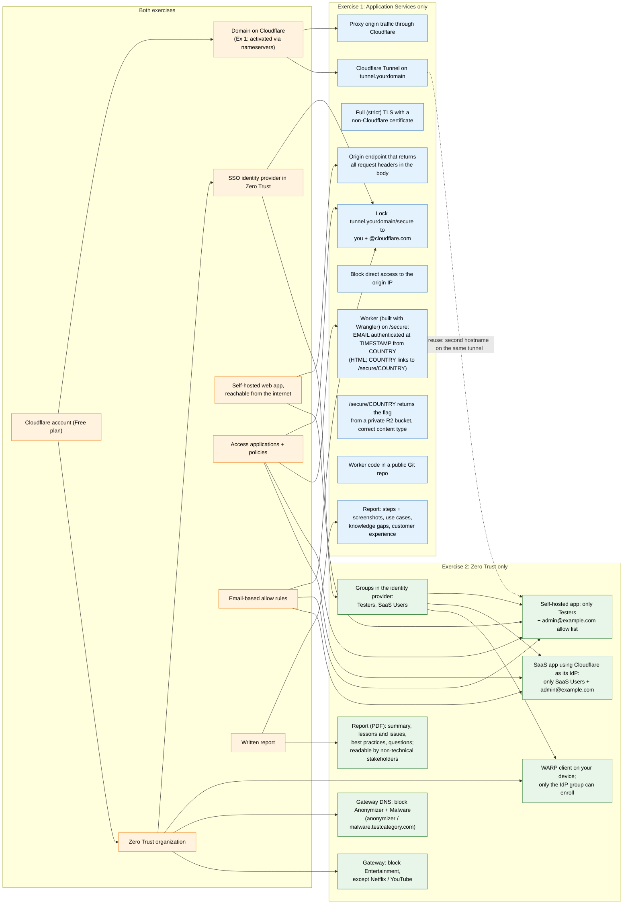

# Assignment requirements and overlap

Two take-home exercises, both designed for Cloudflare's free tier:

- **Exercise 1, Application Services** (`Application_Services_Assignment.pdf`)
- **Exercise 2, Zero Trust** (`Zero_Trust_Services_Assignment.pdf`)

## Requirements map

The left column holds what **both** exercises need. Arrows point from a shared foundation to the exercise
requirements that depend on it. The dotted arrow marks something exercise 1 builds that exercise 2 can reuse.

## Overlap in detail

| Shared requirement | Exercise 1 | Exercise 2 | Build once? |
|---|---|---|---|
| Cloudflare account (Free plan) | Pre-requisite 1 | Implied | Yes |
| Domain on Cloudflare | Pre-requisites 2 and 3 (nameservers changed, zone active) | Pre-requisite 6 | Yes: one active zone serves both |
| Zero Trust organization | Needed for the IdP and Access (steps 5 and 6) | Pre-requisite 1 | Yes |
| SSO identity provider | Step 5: "an SSO IdP of your choosing" | Pre-requisite 4, and the steps need **groups** (Testers, SaaS Users) | Yes: Okta covers both, if it sends groups |
| Self-hosted web app | Step 1: header-echo origin | Pre-requisite 2: "a hosted application that is internet accessible" | Yes: the same origin, a second hostname on the same tunnel |
| Access applications + policies | Step 6: `/secure` path | Self-hosted and SaaS apps | Same building blocks, separate apps |
| Email-based allow rules | You + `@cloudflare.com` | `admin@example.com` allow list | Same rule type (an email list can serve both) |
| Written report | Steps with screenshots, use cases, knowledge gaps, customer experience | Summary, lessons and issues, best practices, questions; PDF, non-technical audience | Separate reports, shared screenshots and diagrams |

Not shared, but worth noting:

- **Cloudflare Tunnel** is required only by exercise 1. Exercise 2's architecture diagram shows a tunnel in front of
  self-hosted apps but doesn't require one, so reusing it there is a design choice, not a requirement.
- **Public Git repo** is required only for the exercise 1 Worker code, but this repo holds both exercises, so keep
  everything in it free of secrets.
- **The reviewers' login:** exercise 1 allows `@cloudflare.com` users, who have no account in your identity provider.
  The `/secure` app also needs a login method they can use, such as the one-time PIN.
