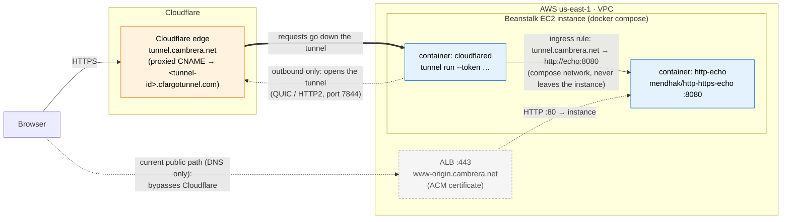

# Topology: Cloudflare Tunnel to the http-echo origin

Draft for discussion (exercise 1, step 4: "Install and configure Cloudflare Tunnel on your origin server using a
subdomain called `tunnel`"). See [requirements.md](requirements.md).

## Reading the diagram

- **The tunnel** is the pair of arrows between `cloudflared` and the edge: `cloudflared` opens it outbound (dotted),
  and the edge sends requests back over that same connection (thick). Nothing connects in to the instance for tunnel
  traffic.
- **`tunnel.cambrera.net` points to Cloudflare's edge**, not the origin: a proxied CNAME to
  `<tunnel-id>.cfargotunnel.com`, so DNS answers with Cloudflare IPs. The origin's address is only in the tunnel's
  ingress rule.
- **`cloudflared` reaches http-echo over the docker compose network** by service name (`http://echo:8080`); that hop
  stays on the instance.
- **Both containers run on the Beanstalk instance**, which is what step 4 asks for ("on your origin server"). Today's
  bundle is a single container (`Dockerrun.aws.json` v1); this needs a `docker-compose.yml` bundle instead, which the
  AL2023 Docker platform supports.
- **The dashed path is what exists today**: `www-origin.cambrera.net` (DNS only) straight to the ALB, bypassing
  Cloudflare. Steps 2 and 3 now run through it: `www.cambrera.net` is proxied (`infra/www_svc`, `tf_cdn`) to
  `www-origin`, with Full (strict) against the ALB's ACM certificate; `cambrera.net` redirects to it. Since step 6's lockdown (option A in
  [origin-lockdown.md](origin-lockdown.md)), the ALB accepts HTTPS only from Cloudflare's IP ranges.

## Open question: the dashed path (steps 2, 3, 6)

| Option | Steps 2 and 3 (proxy, Full strict with a non-Cloudflare certificate) | Step 6 (nobody bypasses Cloudflare) |
|---|---|---|
| **Keep it, proxied** (done for steps 2 and 3, as `www.cambrera.net` proxied to `www-origin`) | The ACM certificate on the ALB gives Full (strict) | The ALB must be locked down to Cloudflare's IP ranges |
| **Drop it**: the tunnel is the only way in | Needs another way to show Full (strict), e.g. the ingress rule to http-echo's HTTPS port (8443) with a non-Cloudflare certificate | Strongest: the ALB and its public exposure go away |
